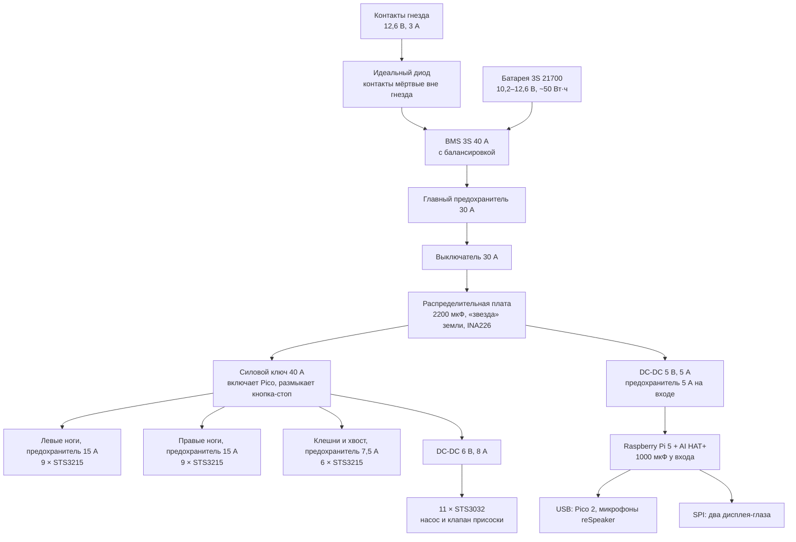

# Харви 1.0 — питание и проводка

Oct 9, 2026 · @HarvestStorm

## Итог

Питание Харви сходится, но в пиках оно на пределе: при ходьбе ноги кратко тянут из батареи до 29 А, а вся система — до \~33 А, и напряжение проседает на \~2 В. Отсюда пять решений, без которых робот либо перезагружался бы, либо был бы небезопасен.

- **Питание приводов «звездой», данные — цепочкой.** Каждая нога получает свой силовой провод от распределительной платы; через разъёмы соседних приводов идёт только сигнал. Иначе ток трёх приводов ноги шёл бы через разъёмы одного.
- **Отдельные преобразователи и «звезда» земли.** Pi и Pico питаются от своего DC-DC 5 В, приводы STS3032 — от своего 6 В, обратные токи приводов не идут через землю плат. Иначе рывок ног перезагружает Pi.
- **Преобразователь 6 В — на 8 А, а не 5 А:** 11 приводов STS3032 и насос присоски дают пики до \~3,5 А, нужен запас на одновременный упор.
- **Аварийное отключение приводов** силовым ключом, которым управляет Pico, и кнопкой-стоп; Pi и Pico при этом остаются включены.
- **Контакты на брюхе «мёртвые» вне гнезда:** зарядный вход через «идеальный диод», иначе на открытых площадках было бы напряжение батареи и упавшая скрепка устроила бы короткое замыкание.

Токи взяты из физической модели (MuJoCo, походка, хвост, клешни, позы) с моделью тока привода по паспорту; реальные значения подтверждаются на стенде.

## Токи по шинам

Главную нагрузку дают ноги: на ходьбе средний ток всего \~5 А, но короткие пики в 3–5 раз выше. Хвост и клешни на фоне ног почти не видны.

| Режим | Шина 12 В (все STS3215): среднее / 99% / пик | из них ноги, пик | Шина 6 В (STS3032 + насос), пик |
| --- | --- | --- | --- |
| Стоит | 1,9 / 2,8 / 3,2 А | 2,6 А | 2,6 А |
| Ходьба, обычный шаг | 5,0 / 16,6 / 24,3 А | 24,0 А | 2,7 А |
| Ходьба, быстрый шаг | 5,9 / 18,8 / 28,9 А | 28,5 А | 2,7 А |
| Хвост кладёт телефон на спину | 2,2 / 3,2 / 3,4 А | 2,6 А | 2,7 А |
| Лечь и встать | 2,6 / 4,4 / 4,4 А | 4,1 А | 2,6 А |
| Клешни к столу и на спину | 2,2 / 2,7 / 3,1 А | 2,6 А | 2,6 А |

«99%» — ток, который не превышается 99% времени; «пик» — максимум за 1 мс. Модель тока привода: холостой ток + момент ÷ постоянная момента (STS3215: 2,94 Н·м при 2,7 А в упоре, STS3032: 0,44 Н·м при 1,2 А) + слагаемое от скорости.

**Электроника** (Pi 5 с ускорителем, камера, микрофоны, дисплеи, Pico, датчики) — около 10–12 Вт, то есть \~2,2–2,5 А на шине 5 В.

**Батарея 3S 21700, \~50 Вт·ч** (85% полезных — \~42 Вт·ч):

| Режим | Мощность от батареи | Хватит на |
| --- | --- | --- |
| Непрерывная ходьба | \~80 Вт | \~30 минут |
| Стоит, думает, говорит | \~38 Вт | \~1 час |
| Лежит на брюхе, приводы отпущены | \~14 Вт | \~3 часа |

Это чуть меньше прежних оценок покоя (4+ ч): теперь учтены ускоритель, микрофоны и токи удержания всех 35 приводов.

## Схема питания

Всё питание расходится из одной распределительной платы: в ней же единственная точка соединения земли. Приводы стоят за силовым ключом, электроника — нет, поэтому аварийный стоп обесточивает моторы, но Pi и Pico продолжают работать и сообщают, что случилось.

Три шины данных приводов (левые ноги, правые ноги, клешни + хвост + глаза + камера) идут от Pico 2 через полудуплексные буферы; земля каждой шины соединена с землёй Pico — без общей земли сигнал не читается.

## Провода, предохранители, конденсаторы

Сечения подобраны под пиковые токи из симуляции с запасом; все силовые провода — в силиконовой изоляции (гибкие, не боятся тепла от приводов).

| Участок | Ток: среднее / пик | Провод | Предохранитель |
| --- | --- | --- | --- |
| Батарея → BMS → выключатель → плата | \~7,5 / 33 А | 14 AWG (2,1 мм²), каждый отрезок ≤ 20 см | 30 А, медленный |
| Плата → левые / правые ноги | \~2,5 / 15 А на сторону | 16 AWG (1,3 мм²) до стороны | 15 А на сторону |
| Ответвление к каждой ноге | \~0,8 / 8 А | 18 AWG (0,8 мм²) | — (защищает предохранитель стороны) |
| Внутри ноги, к каждому приводу | до 2,7 А в упоре | 20–22 AWG, ≤ 10 см, отдельная пара на привод | — |
| Плата → клешни и хвост | \~0,4 / 3,5 А | 18 AWG | 7,5 А |
| DC-DC 6 В → STS3032 и насос | \~0,4 / 3,5 А | 18 AWG | ограничение тока DC-DC |
| DC-DC 5 В → Pi 5 | \~2,3 / 4 А | 18 AWG, ≤ 15 см до разъёма | 5 А на входе DC-DC |
| Сигнальные шины приводов | — | штатные кабели Feetech | — |

**Конденсаторы:** 2200 мкФ 25 В с малым внутренним сопротивлением на распределительной плате, по 470 мкФ 25 В на шинах левых и правых ног, 1000 мкФ 10 В у входа 5 В на Pi. Они сглаживают микросекундные всплески; миллисекундные пики держит сама батарея, поэтому и нужны высокотоковые банки.

**Разъёмы:** XT30 между батареей и платой (рассчитан на 30 А), JST-XH для балансировки, винтовые клеммы или Wago на плате для ответвлений. Падение на питании Pi при 5 А по 30 см провода 18 AWG — \~30 мВ, это в норме.

## Просадки напряжения и защита Pi

Даже на почти пустой батарее в самый сильный пик напряжение не падает ниже \~8 В, а обоим преобразователям для стабильного выхода хватает \~7 В — поэтому при правильной разводке Pi не перезагрузится.

Сопротивление цепи батареи — около 65 мОм: банки 21700 по \~15 мОм, плата BMS, предохранитель, выключатель, разъёмы и провода.

| Заряд | Напряжение в покое | В пике 33 А (−2,1 В) | В 99% времени (≤ 23 А, −1,5 В) |
| --- | --- | --- | --- |
| Полная | 12,6 В | 10,5 В | 11,1 В |
| Половина | 11,1 В | 9,0 В | 9,6 В |
| Почти пустая (3,4 В на банку) | 10,2 В | 8,1 В | 8,7 В |

Что из этого следует:

- **STS3215** работают от 4 В, но их момент на мгновение падает пропорционально напряжению. Симуляция на 10,2 В (сила −19%) уже показала: ходьба в порядке, быстрый шаг — с меньшим запасом.
- **DC-DC 5 В и 6 В** — брать с входом до 16 В и падением на ключе не больше \~1 В: тогда при 8 В на входе выходы держатся.
- **Pi 5** перезагружается, если на его входе меньше \~4,75 В. Защита: свой DC-DC, конденсатор 1000 мкФ у входа, «звезда» земли, короткий толстый провод.
- **Pico следит за напряжением через INA226** и сам решает: ниже 9,0 В больше 0,1 с во время движения — снизить скорость и усилие; ниже 10,5 В в покое (3,5 В на банку) — идти в гнездо; ниже 9,9 В (3,3 В на банку) — лечь, отпустить приводы, сохранить состояние.
- **Разгон приводов не одновременно:** трипод и так нагружает три ноги по очереди; при вставании и позах лучше раздвигать старт ног на 20–50 мс. У STS3215 есть ограничение тока в настройках — включить его.

## Распиновка и шины приводов

Всё помещается без конфликтов, но у Pico 2 заняты все 26 свободных выводов — запаса нет. Если позже понадобятся ещё датчики, их стоит повесить на I2C или перенести касания на Pi.

**Raspberry Pi Pico 2 — «спинной мозг»**

| Назначение | Выводы |
| --- | --- |
| Шина A: левые ноги, 9 × STS3215 (UART0) | GP0 TX, GP1 RX, GP2 направление |
| Шина B: правые ноги, 9 × STS3215 (UART1) | GP4 TX, GP5 RX, GP6 направление |
| Шина C: клешни, хвост, глаза, камера — 6 × STS3215 и 11 × STS3032 (UART на PIO) | GP8 TX, GP9 RX, GP10 направление |
| I2C: 6 × VL53L4CD, IMU, INA226 | GP12 SDA, GP13 SCL |
| Линии XSHUT шести датчиков края | GP14–GP19 |
| Прерывание IMU | GP20 |
| Четыре сенсора касания TTP223 | GP21, GP22, GP26, GP27 |
| Насос и клапан присоски (через MOSFET) | GP3, GP7 |
| Силовой ключ приводов | GP11 |
| Кнопка-стоп (вход) | GP28 |
| Связь с Pi | USB |

Адреса на I2C: датчики края после переназначения через XSHUT — 0x30–0x35, IMU BMI270 — 0x68, INA226 — 0x40; совпадений нет.

**Raspberry Pi 5 — «голова»**

| Назначение | Выводы и разъёмы |
| --- | --- |
| Два дисплея GC9A01 (SPI0) | MOSI GPIO10, SCLK GPIO11, CE0 GPIO8 — левый глаз, CE1 GPIO7 — правый |
| Управление дисплеями | DC GPIO25, RST GPIO24 (общие), подсветка GPIO18 (ШИМ, общая) |
| Камера с приводом наклона | CAM1, кабель 22 → 15 контактов |
| Ускоритель AI HAT+ | PCIe, стоит сверху на 40-контактном разъёме |
| Питание 5 В | контакты 2 и 4, земля 6 и 9 (через сквозной разъём HAT); в config.txt `usb_max_current_enable=1` |
| Микрофоны reSpeaker XVF3800 | USB 3 |
| Pico 2 | USB 2 |
| Вентилятор | разъём FAN (Active Cooler) |

**Скорость шин.** На 1 Мбит/с одна команда всем приводам шины уходит одним пакетом, а опрос состояния занимает \~0,25 мс на привод: шины ног — \~2,3 мс, шина C с 17 приводами — \~4,3 мс. Цикл 50 Гц (20 мс) выполняется с запасом, 100 Гц — тоже. На шине C приводы на 12 и 6 В делят только провод данных, питание у них раздельное.

**Уровни сигнала.** По даташиту STS3215-C018 логическая «1» на шине — от 2 до 5 В, «0» — до 0,45 В, так что 3,3 В от Pico подходят напрямую. Полудуплекс собирается по схеме Feetech: буферы 74LVC1G125 и 74LVC1G126 с питанием 3,3 В, линия направления от Pico. Встроенная защита привода: отключение момента при перегреве выше 70 °C, при токе выше 2 А дольше 2 с и при напряжении выше 14 или ниже 4 В — пики ходьбы короткие и её не задевают.

## Безопасность

Четыре вещи защищают и Харви, и тех, кто рядом, от ошибок питания.

- **Аварийная отсечка приводов.** Силовой ключ на MOSFET на 40 А стоит между платой и всеми приводами. Его включает Pico, а кнопка-стоп на корпусе размыкает его напрямую, без участия программы. Pico сам отключает приводы, если ток держится выше 35 А дольше 0,2 с, если перегрелся привод или если Харви застрял и упирается. Pi и Pico при этом остаются включены.
- **Мёртвые контакты на брюхе.** Зарядный вход идёт через «идеальный диод»: ток течёт только внутрь. Без гнезда на площадках нет напряжения, и скрепка или ключи на столе ничего не замкнут. Гнездо, в свою очередь, подаёт 12,6 В только когда опознало робота.
- **Порядок включения.** Выключатель → BMS → плата; электроника запускается сразу, а ключ приводов Pico включает только после самопроверки: напряжение в норме, все приводы откликнулись на шинах, Харви стоит на ногах. При выключении — наоборот: сначала Харви ложится и отпускает приводы, потом гаснет ключ.
- **Батарея.** Заряжать только через BMS с балансировкой и только в гнезде; при нагреве банок выше 50 °C (датчик температуры BMS) заряд прерывается. Банки — оригинальные высокотоковые 21700 у проверенного продавца: подделки с завышенной ёмкостью не держат ток 30 А.

## Изменения в покупках и проверка на стенде

Правильное питание добавляет к бюджету примерно 2,5–5 тыс. ₽ — это самая дешёвая страховка во всём проекте.

| Позиция | Ориентировочно, ₽ |
| --- | --- |
| DC-DC 6 В на 8 А вместо 5 А | +200–500 |
| Распределительная плата: держатели предохранителей 30, 15, 15, 7,5 и 5 А, клеммы, медная шина или макетка | 500–1 000 |
| Силовой ключ на MOSFET 40 А (готовый модуль) и кнопка-стоп | 500–1 000 |
| Модуль «идеальный диод» на 10 А для зарядного входа | 200–500 |
| Конденсаторы: 2200 мкФ × 1, 470 мкФ × 2, 1000 мкФ × 1 | 200–400 |
| 3 преобразователя уровня 74LVC1T45 для шин приводов | 100–300 |
| Силиконовые провода 14, 16, 18 и 22 AWG, разъёмы XT30, наконечники | 800–1 500 |

Что измерить на стенде — эти числа подтверждают или поправляют расчёт:

1. **Ток одного STS3215 в упоре** на 12,6 и 10,2 В. Ожидание — около 2,7 А; если больше на 20%, пересчитываем предохранители.
2. **Ток ноги из трёх приводов** при резком шаге и нагрев её разъёмов. Ожидание — пики до \~8 А.
3. **Просадку батареи** под нагрузкой \~30 А (электронная нагрузка или несколько упёртых приводов). Ожидание — около 2 В.
4. **Устойчивость Pi 5**: ускоритель под нагрузкой, а приводы в это время резко дёргаются. Норма — ни одной перезагрузки и `vcgencmd get_throttled` = 0x0.
5. **Уровень сигнала шины Feetech** — мультиметром или осциллографом, чтобы выбрать питание преобразователей уровня.
6. **Нагрев DC-DC и силового ключа** за 30 минут в закрытом корпусе. Норма — не выше 60–70 °C.

## Связанные заметки

[[Харви]] · [[Комплектация и бюджет v0.2]] · [[Этап 1 — покупки и стенд одной ноги]] · [[Проверка совместимости и сценарии]]
